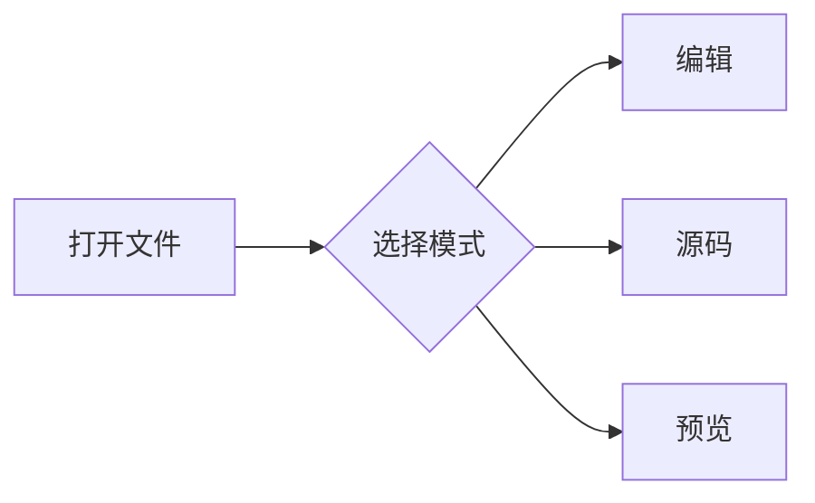
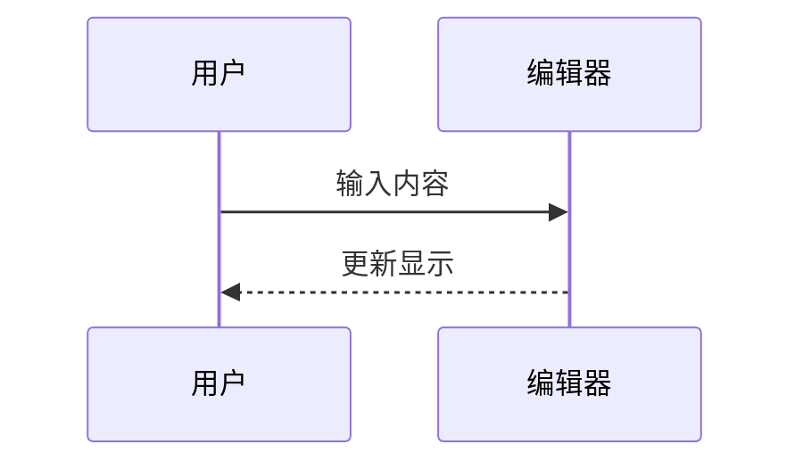
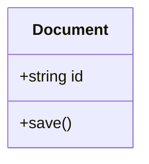
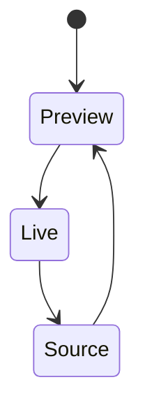
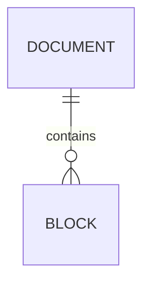

# Markdown、LaTeX 与 Mermaid 示例

使用 MD Lite 打开本文件，默认进入预览模式。

- **Ctrl+1**：即时预览编辑，点击公式或图表可展开源码。
- **Ctrl+2**：查看和编辑完整 Markdown 源码。
- **Ctrl+3**：只读预览。

本示例包含四种数学定界符、矩阵、多行公式，以及流程图、时序图、类图、状态图和 ER 图。

---

## LaTeX 公式
行内 $E=mc^2$，以及 \(a^2+b^2=c^2\)。

$$
A=\begin{bmatrix}
1 & 2 \\
3 & 4
\end{bmatrix}
$$

\[
\int_0^1 x^2\,dx=\frac{1}{3}
\]

$$
\begin{aligned}
f(x)&=x^2+2x+1\\
&=(x+1)^2
\end{aligned}
$$

## Mermaid 图表

