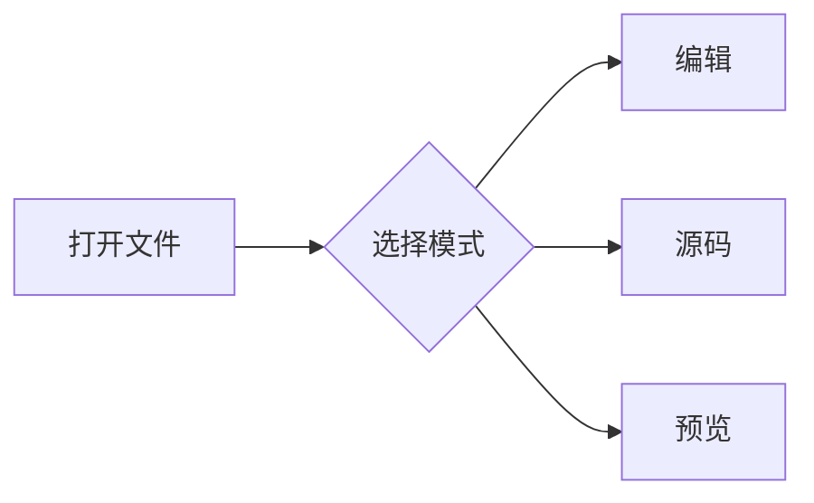

# 图 0

段落

段落

段落

段落

段落

段落

段落

段落

段落

段落

段落

段落

段落

段落

段落

段落

段落

段落

段落

段落

# 图 1

段落

段落

段落

段落

段落

段落

段落

段落

段落

段落

段落

段落

段落

段落

段落

段落

段落

段落

段落

段落

# 图 2

段落

段落

段落

段落

段落

段落

段落

段落

段落

段落

段落

段落

段落

段落

段落

段落

段落

段落

段落

段落

# 图 3

段落

段落

段落

段落

段落

段落

段落

段落

段落

段落

段落

段落

段落

段落

段落

段落

段落

段落

段落

段落

# 图 4

段落

段落

段落

段落

段落

段落

段落

段落

段落

段落

段落

段落

段落

段落

段落

段落

段落

段落

段落

段落

# 图 5

段落

段落

段落

段落

段落

段落

段落

段落

段落

段落

段落

段落

段落

段落

段落

段落

段落

段落

段落

段落

# 图 6

段落

段落

段落

段落

段落

段落

段落

段落

段落

段落

段落

段落

段落

段落

段落

段落

段落

段落

段落

段落

# 图 7

段落

段落

段落

段落

段落

段落

段落

段落

段落

段落

段落

段落

段落

段落

段落

段落

段落

段落

段落

段落

# 图 8

段落

段落

段落

段落

段落

段落

段落

段落

段落

段落

段落

段落

段落

段落

段落

段落

段落

段落

段落

段落

# 图 9

段落

段落

段落

段落

段落

段落

段落

段落

段落

段落

段落

段落

段落

段落

段落

段落

段落

段落

段落

段落

# 图 10

段落

段落

段落

段落

段落

段落

段落

段落

段落

段落

段落

段落

段落

段落

段落

段落

段落

段落

段落

段落

# 图 11

段落

段落

段落

段落

段落

段落

段落

段落

段落

段落

段落

段落

段落

段落

段落

段落

段落

段落

段落

段落

# 图 12

段落

段落

段落

段落

段落

段落

段落

段落

段落

段落

段落

段落

段落

段落

段落

段落

段落

段落

段落

段落

# 图 13

段落

段落

段落

段落

段落

段落

段落

段落

段落

段落

段落

段落

段落

段落

段落

段落

段落

段落

段落

段落

# 图 14

段落

段落

段落

段落

段落

段落

段落

段落

段落

段落

段落

段落

段落

段落

段落

段落

段落

段落

段落

段落

# 图 15

段落

段落

段落

段落

段落

段落

段落

段落

段落

段落

段落

段落

段落

段落

段落

段落

段落

段落

段落

段落

# 图 16

段落

段落

段落

段落

段落

段落

段落

段落

段落

段落

段落

段落

段落

段落

段落

段落

段落

段落

段落

段落

# 图 17

段落

段落

段落

段落

段落

段落

段落

段落

段落

段落

段落

段落

段落

段落

段落

段落

段落

段落

段落

段落

# 图 18

段落

段落

段落

段落

段落

段落

段落

段落

段落

段落

段落

段落

段落

段落

段落

段落

段落

段落

段落

段落

# 图 19

段落

段落

段落

段落

段落

段落

段落

段落

段落

段落

段落

段落

段落

段落

段落

段落

段落

段落

段落

段落

